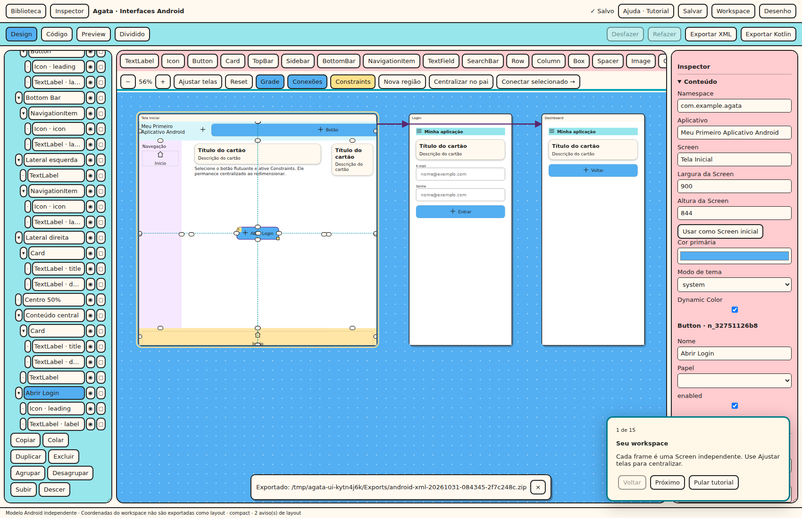

# Meu Primeiro Aplicativo Android

**Objetivo:** construir e testar um app com três Screens, componentes editáveis e navegação.
Não é preciso escrever Kotlin para acompanhar as práticas.

1. Na home, clique em **Novo projeto**. Informe um nome e selecione Android.
2. Em **Modelo**, escolha **Meu Primeiro Aplicativo Android**. A opção **Projeto vazio** continua disponível.
3. Clique em **Criar prancheta**. O editor Android abre Tela Inicial, Login e Dashboard.
4. Na caixa de apresentação, escolha **Iniciar tutorial**. Use Próximo/Voltar; quando houver
   uma prática, execute a ação ou escolha explicitamente **Pular esta prática**.
5. Explore a Tela Inicial na árvore: Top Bar, duas laterais, conteúdo central, Bottom Bar,
   guideline de 50% e botão Abrir Login são componentes separados, editáveis.
6. Selecione **Top Bar** na árvore. Escolha Button na biblioteca, marque **Inserir como filho
   selecionado** e clique em Inserir componente. Altere o texto expandindo os filhos do botão.
7. Selecione **Abrir Login**, ative **Constraints** e observe as linhas azuis. Setas roxas
   ligam Screens por eventos; linhas azuis posicionam componentes na mesma Screen.
8. Abra Preview. Clique em Abrir Login e depois em Entrar: você chegará ao Dashboard.
   Voltar usa o histórico. É uma demonstração local de navegação, sem autenticação de servidor.
9. Alterne celular/tablet, gire e amplie a fonte. As laterais usam regras de visibilidade;
   o botão mantém centralização por constraints, sem escala proporcional do desenho.
10. Salve. Feche e reabra: Screens, links, camadas e conteúdo permanecem no projeto.
11. Use **Ajuda · Tutorial** para retomar ou reiniciar. Escape pausa o tour. Alt+seta direita
    avança quando a etapa está liberada; Alt+seta esquerda volta. O tour não bloqueia a prática.

## Exercícios

- Troque o título, o ícone e o destino do botão da Top Bar.
- Crie uma quarta Screen e um botão de retorno.
- Oculte a lateral direita em medium e confira a diferença para expanded.
- Pause o tutorial, reabra o projeto e retome pelo menu Ajuda.

## Problemas comuns

| Problema | Solução |
|---|---|
| Botão inserido fora da barra | Selecione o contêiner e marque Inserir como filho selecionado; ou arraste pela árvore |
| Próximo desabilitado | Faça a prática; Pular esta prática permite avançar sem alterar o projeto |
| Alvo do tutorial não aparece | O tour tenta abrir o painel e rolar até ele. Use Voltar ou pule a prática se o alvo não existir |
| Nome de projeto/tutorial não muda o título do app | Edite Aplicativo no Inspector; são nomes independentes |
| Tutorial não aparece automaticamente | Ajuda sempre permite abri-lo. Não mostrar novamente desativa ofertas automáticas neste perfil do navegador |

O progresso do tour é guardado por projeto no armazenamento local do perfil WebView. O botão
Salvar guarda o modelo do app; não existe autosave. A prática pode deixar Screens/componentes
novos, que você pode remover ou desfazer após pausar o tour.

## Fluxos adicionais

O projeto padrão agora inclui Perfil, Chart e DrawingCanvas com estrela editável no Dashboard.
Ajuda oferece tours separados de setinhas/bias, navegação onClick, Balde/Canvas/gráficos e
edição/exportação. Veja [Navegação](NAVEGACAO_VISUAL.md), [Desenho](DESENHO_E_GRAFICOS.md) e
[Código](EDITANDO_CODIGO.md). A galeria mantém vazio e acrescenta autenticação demonstrativa,
dashboard, barras, regiões laterais, perfil, configurações, formulário, catálogo, lista/detalhes e tarefas.

Ctrl/Cmd+Z desfaz um passo e Ctrl/Cmd+Shift+Z refaz. Solte a tecla para o próximo passo:
a repetição automática de tecla é ignorada. No editor de desenho, alterações nas partes de
um componente também são individuais; desfazer Concluir retorna à edição das partes.
