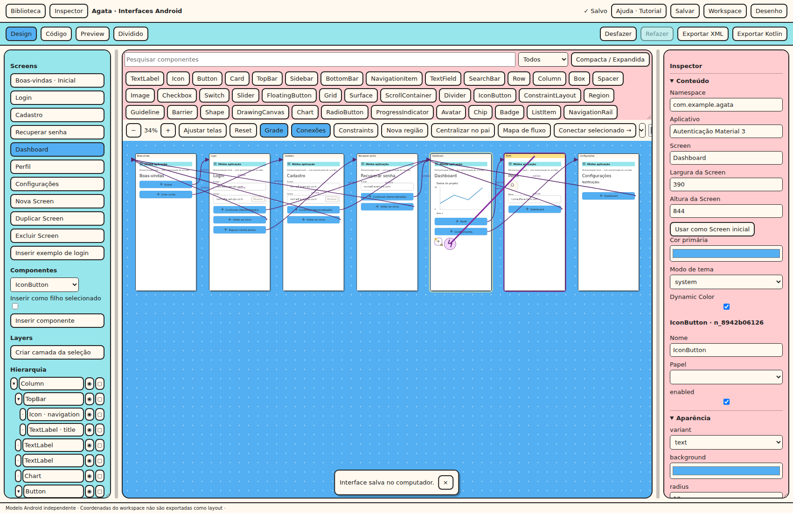

# Ligar onClick a outra Screen

**Objetivo:** configurar Login → Dashboard → Perfil pelo Inspector e pelo conector.

1. Crie **Autenticação Material 3 (demonstração)** na criação de projetos.
2. Selecione Login e o Button Continuar na árvore. Abra **Eventos > onClick**.
3. Escolha **Navegar para Screen**, pesquise Dashboard e selecione o destino. A miniatura
   é renderizada a partir dos componentes da Screen, não uma imagem estática.
4. Escolha push para manter a origem, replace para substituir o topo ou popUpTo para remover
   entradas até uma Screen escolhida. IDs permanecem estáveis ao renomear Screens.
5. No Dashboard, insira IconButton e selecione-o. Arraste o **raio roxo** do componente até Perfil.
   Durante o movimento aparece uma linha roxa e o frame de destino recebe realce.
6. Clique na seta onClick para selecionar a origem e editar pelo Inspector. Delete com a
   conexão focada remove o evento; Selecionar Screen de destino abre o alvo na hierarquia.
7. Abra Mapa de fluxo para listar relações, Screens sem entrada e destinos excluídos.
8. No Preview, navegue e use Voltar. Itens de navegação com destino igual à Screen atual
   recebem destaque. As linhas de workspace não aparecem no app.
9. Salve/reabra e exporte os dois backends. Compose recebe handlers NavController; XML
   inclui Activity Kotlin com histórico e listeners. Layout XML sozinho não navega.

**Exercícios:** renomeie Perfil, exclua-a e desfaça. O ID não muda ao renomear. Excluir marca
os eventos como quebrados; eles podem ser salvos, mas a exportação exige escolher outro destino
ou remover a ação. Não há redirecionamento silencioso.

Abrir URL aceita apenas HTTP/HTTPS e gera Intent no app nativo; Preview informa o endereço.
Ação nomeada é um sinal/Toast, não executa JavaScript/Kotlin fornecido pelo usuário.
Parâmetros de rota tipados e transições personalizadas ainda não são oferecidos nesta versão.
